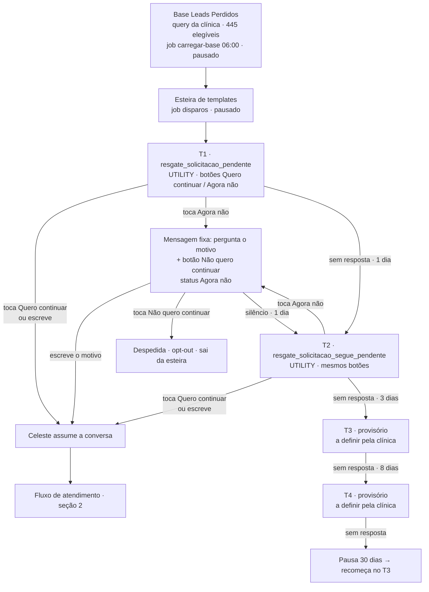
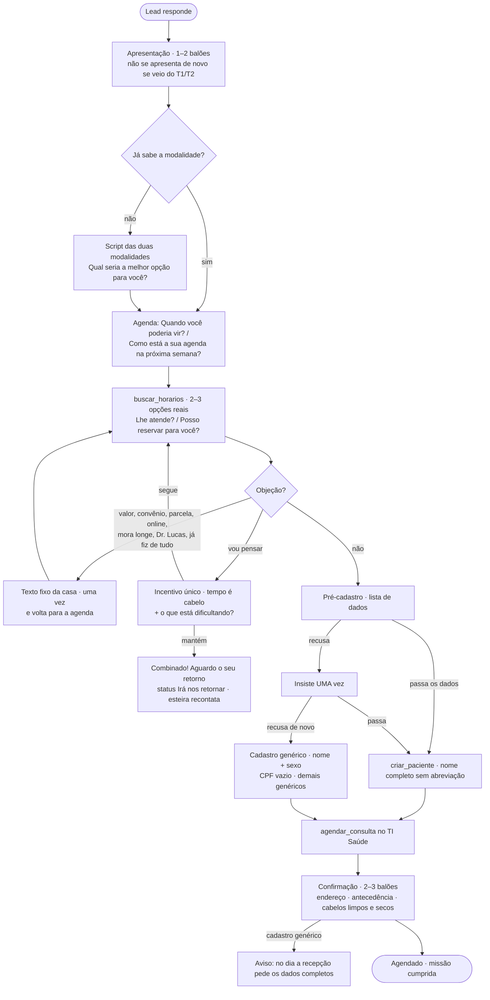

# Fluxograma — Leads Perdidos (Celeste) · estado em 14/10/2026

Documento vivo. Fonte da verdade do que está no ar: `config/parametros.yaml` (esteira, textos fixos), `src/celeste/jobs/templates_texto.py` (templates), `prompts/leads-perdidos-v0.md` (roteiro) e `knowledge/03-exemplos-de-conversas.md` (exemplos reais que a Celeste imita).

## 1. Visão geral

## 2. Atendimento pela Celeste (dentro da janela de 24 h)

### Regras transversais (sempre)

- **Consulta já marcada:** se o lead falar dela, `consultar_agendamento` antes de responder; nunca deduzir por horários livres.
- **Cancelamento:** 1) pergunta o motivo → 2) oferece solução → 3) só cancela se o lead insistir depois da solução (a ferramenta recusa sem os três).
- **Alteração cadastral a pedido:** qualquer dado, inclusive CPF; nome a API não altera → registra para a recepção.
- **Recepção só em 4 casos:** já é paciente em tratamento; assunto clínico; reclamação/reembolso; pediu pessoa. Botão "Falar com Recepção".
- **Horários:** sempre da agenda do TI Saúde; sem lista de feriados; orientação de que a clínica não atende fim de semana nem feriado.
- **Nunca:** diagnosticar, valor de tratamento, desconto, parcelar consulta, online, convênio, inventar informação (→ `sinalizar_revisao`), dizer que é IA.

## 3. O que ainda não existe (pendente)

| Item | Estado |
|---|---|
| T3 e T4 definitivos | a definir pela clínica (hoje: textos antigos do MarketZap, não cadastrados na Meta) |
| Lembrete de retomada no mesmo dia | implementado (texto fixo por etapa), scheduler pausado |
| Confirmação de presença (D-1), lembrete do dia, pós-consulta | dependem de templates de utilidade ainda não criados |
| Ligar a esteira e a base | decisão da clínica para o piloto |

## 4. Custos por lead (ordem de grandeza)

- Template de utilidade: centavos de dólar por envio. Conversa típica com a Celeste (8–10 respostas): ~US$ 0,35–0,45. Renovação de cache: ~US$ 0,60/dia.
